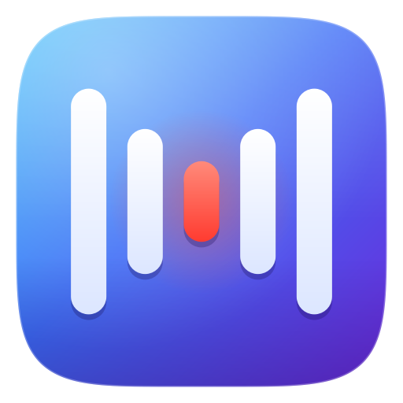
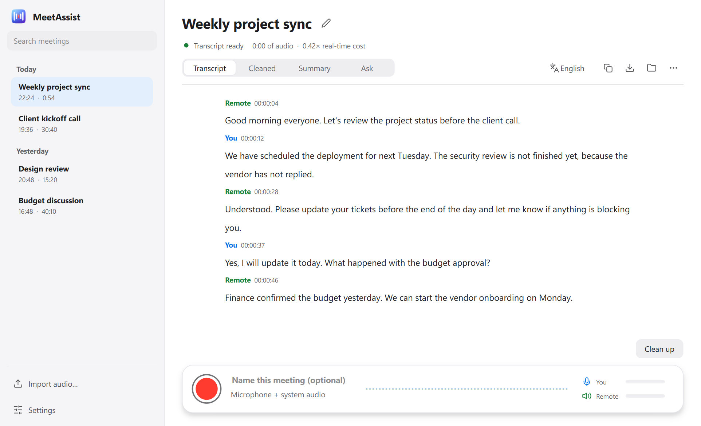
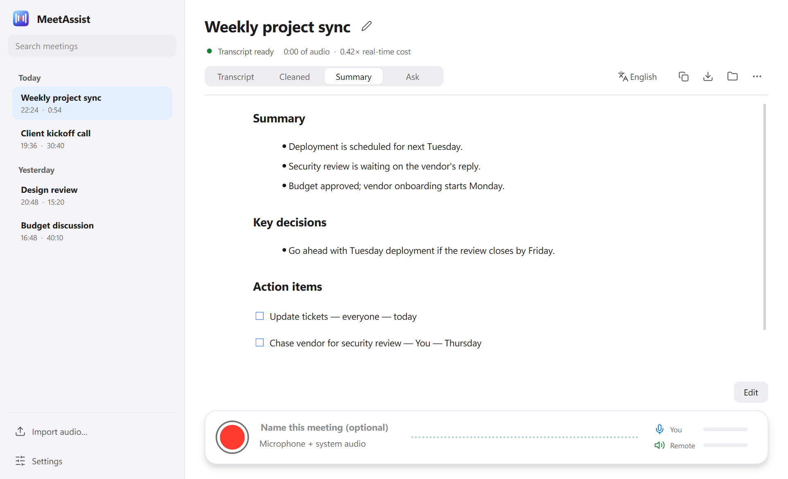

<p align="center">
  
</p>

<h1 align="center">MeetAssist</h1>

<p align="center">
  A local-first Windows meeting recorder with live Tamil / English / Tanglish transcription.<br>
  No cloud speech recognition, no telemetry — everything runs on your laptop.
</p>

<p align="center">
  <a href="LICENSE"></a>
  
  
  <a href="https://github.com/11prem/MeetAssist/actions/workflows/tests.yml"></a>
</p>

<p align="center">
  
</p>

## What it does

Press record and MeetAssist captures **your microphone and everyone on the call** (system audio), and
builds a transcript live — ready about 10-15 seconds after you stop. Speech can mix **Tamil, English and
Tanglish** in the same sentence; MeetAssist understands all three and reads it back to you however you like.

Everything above the "optional AI features" line runs **entirely on your machine**: audio never leaves
your laptop, and the app makes zero network calls unless you explicitly turn on transcript clean-up /
summaries and point it at an LLM endpoint of your choice.

- 🎙️ **Records mic + system audio** (Teams / Zoom / Webex / Meet, anything playing through Windows)
- 🗣️ **Tamil + English + Tanglish**, transcribed and normalized to English by default, with a one-click
  switch to Tanglish spelling or native Tamil script
- ⚡ **Live, incremental transcription** — no waiting for the recording to end
- ✨ **Optional AI clean-up, summaries and Q&A** — bring your own OpenAI-compatible LLM endpoint
  (DeepSeek, OpenAI, a local Ollama server, whatever you have access to)
- 🔒 **Local-first by design** — raw audio and transcripts live in a folder on disk; nothing is uploaded
  unless you ask for it
- 🪟 **No install, no admin rights** — portable app, light/dark theme, follows Windows automatically

<p align="center">
  
</p>

## How it understands Tamil, English and Tanglish

Two speech engines run side by side, locally:

- **IndicConformer** ([AI4Bharat](https://github.com/AI4Bharat)) — very accurate Tamil, recognised in Tamil
  script.
- **Whisper** (via [faster-whisper](https://github.com/SYSTRAN/faster-whisper)/CTranslate2) — very
  accurate English.

For every sentence, MeetAssist decides automatically which engine to trust and **translates Tamil and
Tanglish into English** so the whole transcript reads naturally — for example *"im going start a fund athu
ethukaaga na its for a trip"* becomes *"I'm going to start a fund, that is for a trip."* The original Tamil
is always kept behind the scenes, never discarded.

A dropdown above the transcript switches how Tamil is shown: **English translation** (default), **Tanglish
spelling**, or **native Tamil script** — this also applies to copy/save.

## Getting started

### Requirements

- Windows 10/11, 64-bit
- Python 3.11
- 8 GB RAM minimum (16 GB recommended — the speech models use ~3 GB while recording)

### 1. Clone and install dependencies

```bash
git clone https://github.com/11prem/MeetAssist.git
cd MeetAssist
pip install -r requirements.txt
```

### 2. Get the speech models

MeetAssist loads speech models from a local `models/` folder next to the `meetassist/` package — they are
**not** included in this repo (a few GB of binary weights). Create this layout:

```
models/
├── ct2-small/           # faster-whisper small, CTranslate2 format (required)
└── indic-asr/
    └── assets/
        ├── encoder.onnx     # AI4Bharat IndicConformer (required for Tamil/hybrid mode)
        └── ctc_decoder.onnx
```

- `ct2-small` — download from [`Systran/faster-whisper-small`](https://huggingface.co/Systran/faster-whisper-small)
  (swap in `faster-whisper-medium` or `-large-v3-turbo` under `models/ct2-<size>/` for more accuracy at the
  cost of speed; pick the active one in Settings).
- `indic-asr` — download from [`ai4bharat/indic-conformer-600m-multilingual`](https://huggingface.co/ai4bharat/indic-conformer-600m-multilingual).

If `huggingface.co` is blocked on your network, both are also mirrored on
[ModelScope](https://modelscope.cn) — `tools/ms_download.py <owner/name> <dest_dir>` fetches a ModelScope
repo without any extra dependencies beyond `requests`.

English-only use needs just `ct2-small`; Tamil/Tanglish needs `indic-asr` too.

### 3. (Optional) Connect an LLM for clean-up, summaries and Q&A

Transcription itself needs no network access at all. If you want AI clean-up / summaries / "ask about this
meeting", open **Settings → AI** and enter the base URL + API key of any OpenAI-compatible
`/chat/completions` endpoint (DeepSeek, OpenAI, Azure OpenAI, a local Ollama/vLLM server, etc.). This is the
**only** thing in the app that ever touches the network, and only when you trigger it.

### 4. Run it

```bash
python -m meetassist.app
```

## The window

- **Left:** your meetings, grouped by day, with search across titles and transcript text. Import audio and
  Settings live at the bottom.
- **Centre:** the transcript, in four tabs — **Transcript**, **Cleaned**, **Summary**, **Ask** — with copy,
  save, open-folder and more actions.
- **Bottom:** the recorder — big red button, live timer, a live waveform (blue = you, green = remote) and
  level meters. Click the microphone/speaker icon to record just one side.
- Light and dark mode, follows Windows automatically (force one in Settings → Appearance).
- Shortcuts: `Ctrl+R` start/stop, `Ctrl+O` import, `Ctrl+F` search, `Ctrl+S` save, `Ctrl+Shift+C` copy,
  `Ctrl+,` settings.

| Feature | What it does |
|---|---|
| **Start / Stop recording** | Records microphone → labelled *You*, and system audio (remote call participants) → labelled *Remote*. |
| **Import audio…** | Transcribe an existing recording (`.m4a` `.mp3` `.wav` `.mp4` …). |
| **Copy / Save as…** | Copy the transcript or save as `.txt`, `.md` (with summary) or `.srt` subtitles. |
| **Clean up** | Your LLM polishes the raw transcript (fixes mis-recognised names/terms); the original is always kept. |
| **Summarize** | Your LLM writes a summary, decisions, action items and open questions. |
| **Ask** | Ask free-form questions about a meeting; answered from its transcript + summary. |
| **Re-transcribe** | Re-run speech recognition on the saved audio with a different model; the previous transcript is kept as a backup. |
| Right-click a meeting | Rename, open its folder, or delete it (deletes the audio too). |

## Where things are stored

- Meetings, transcripts and raw audio: `%LOCALAPPDATA%\MeetAssist\meetings\<date-time>\`
  (`raw\` = audio, `journal.jsonl` = transcript, `exports\` = saved files).
- Settings: `%LOCALAPPDATA%\MeetAssist\settings.json` — the LLM API key is stored encrypted for your
  Windows user account.
- Raw audio is only ever deleted when **you** delete the meeting.
- Log file for troubleshooting: `%LOCALAPPDATA%\MeetAssist\app.log`.

## Privacy

Speech recognition is 100% local. The app makes **no network connection** at all except to the LLM address
you configure yourself, and only when you click *Clean up* / *Summarize* / *Ask* (or opt in to automatic
clean-up). Before the first recording the app reminds you to make sure the meeting may be recorded —
check your own organization's recording/compliance policy before recording calls that aren't just yours.

## Architecture

- **UI** (`meetassist/ui/`) — PySide6 desktop app.
- **Capture** (`meetassist/capture_proc.py`) — a separate OS process records mic + WASAPI loopback audio,
  so a transcription hiccup can never drop audio.
- **Transcription** (`meetassist/asr_worker.py`, `transcriber.py`, `indic.py`, `segmenter.py`) — another
  separate process: streaming VAD segmentation, then faster-whisper (English) and/or IndicConformer
  (Tamil), packed into batches for throughput.
- **LLM** (`meetassist/llm.py`) — the only module that ever makes a network call, and only for the
  optional clean-up/summary/ask features; raw transcript text is never overwritten, only ever stored
  alongside the corrected version.

Capture, transcription and the UI run as independent processes so a slow or crashing transcriber can never
block or lose audio capture.

## Development

```bash
pip install -r requirements.txt
pytest
```

Tests that need the actual speech models skip automatically if `models/` isn't populated. See
[`AGENTS.md`](AGENTS.md) for the project's hard rules (never block capture, never delete raw audio
early, never silently overwrite the raw transcript, etc.) — please keep to them in any contribution.

Contributions, issues and feature requests are welcome — open an issue or a PR.

## License

[MIT](LICENSE)
